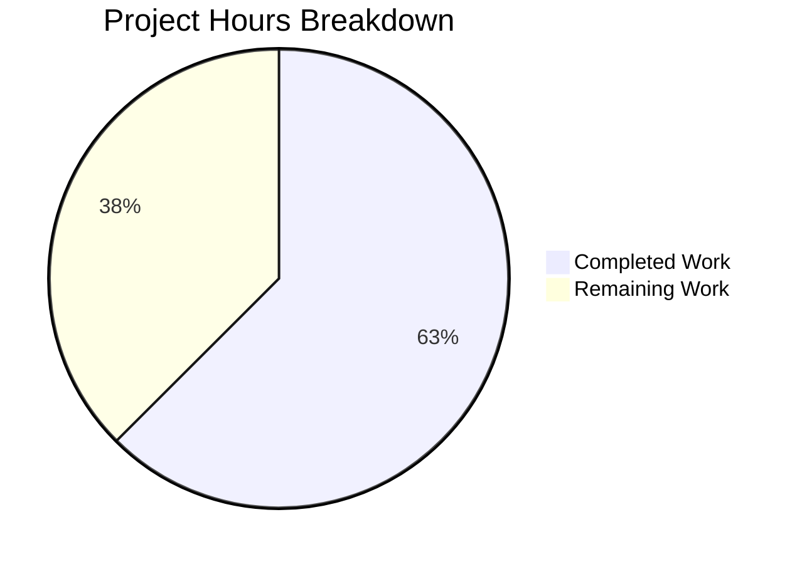
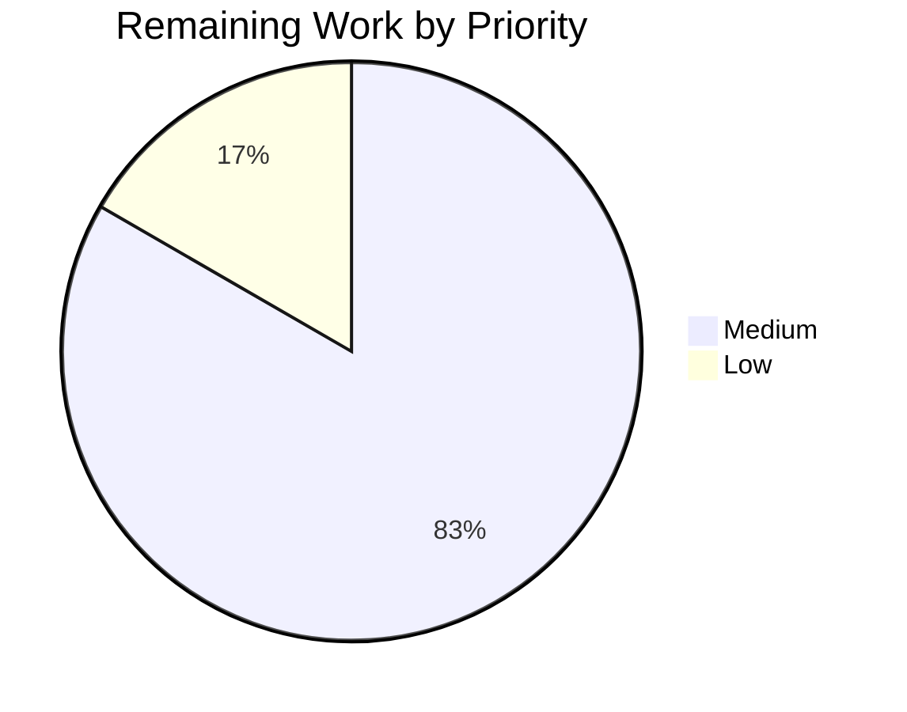

# 1. Executive Summary

## 1.1 Project Overview

A deliberately minimal Node.js console program: `node index.js`, run from the repository root, writes the single line `Welcome to Blitzy` to standard output and exits 0. It reads no arguments, input or environment variables, and standard output is its only interface — no service, port, data store, configuration or user interface. Developers and automated checks use it to assert one command's output and exit status. The scope is two files at the repository root, `index.js` and `README.md`; a Node.js runtime of 18 LTS or later is the only prerequisite.

## 1.2 Completion Status

5.0 of the 8.0 hours this scope carries are complete — 62.5%. Functionality is complete and verified; the rest is verification breadth, two acceptance decisions and release handoff.



*Completed Work = Dark Blue (#5B39F3) · Remaining Work = White (#FFFFFF).*

| Metric | Hours |
|---|---|
| Total Hours | 8.0 |
| Completed Hours (AI + Manual) | 5.0 |
| Remaining Hours | 3.0 |

## 1.3 Key Accomplishments

- ✅ Greeting output — `node index.js` writes exactly `Welcome to Blitzy` plus one newline (18 bytes) and exits 0.
- ✅ Output purity — no ANSI escapes, control bytes or extra output; standard error stays empty.
- ✅ Invocation contract — 16 argument variants, 6 input payloads, 6 environment cases, 3 working directories: identical output.
- ✅ Determinism — 10 sequential and 20 concurrent runs identical; nothing written to disk.
- ✅ Runtime — CommonJS parses under `node --check` and loads under `require()`; no manifest or dependency.
- ✅ Documentation — the `README.md` command reproduces the acceptance output verbatim.
- ✅ Repository shape — two tracked files; no manifest, lockfile, dependency, test or configuration.
- ✅ Scope discipline — 3 insertions and 2 deletions across those two paths.

## 1.4 Critical Unresolved Issues

4 open items. Of the six in-scope deliverables, none is unimplemented; two carry an open item and two are release-level.

| Issue | Impact | Owner | ETA |
|---|---|---|---|
| Runtime floor and cross-platform behaviour unmeasured (Node.js 18 LTS, non-Linux) | The compatibility statement rests on a one-line code path rather than on measurement | Project owner | 2.0h |
| Greeting discarded silently when stdout's destination fails (a full device, or a consumer closing the pipe) | An automated caller cannot tell the output was lost; no error path may be added within the fixed scope | Project owner | 0.5h decision |
| `README.md` states no runtime prerequisite and no working directory | A reader without Node.js 18 or later gets a bare shell error | Project owner | 0.5h decision |
| Release handoff not performed | Consumers have no tagged version to depend on | Project owner | 0.5h |

## 1.5 Access Issues

No access issues identified — no credential, service, port, database, external API or repository permission is required, and nothing needs starting.

## 1.6 Recommended Next Steps

1. [Medium] Confirm the greeting on Node.js 18 LTS and on a second platform (2.0h).
2. [Medium] Record the decision on the failing-output caveat and the README prerequisite note (0.5h).
3. [Low] Tag the release and confirm a fresh clone holds exactly the two files (0.5h).
4. [Low] Keep the two-file, zero-dependency boundary intact in review.

# 2. Project Hours Breakdown

## 2.1 Completed Work Detail

| Component | Hours | Description |
|---|---|---|
| Greeting script (`index.js`) | 1.0 | One-line JSDoc summary plus a single `console.log('Welcome to Blitzy');` statement in conventional CommonJS — the entire program logic |
| Run-command documentation (`README.md`) | 0.5 | The single line stating `node index.js`, which is the whole documented interface |
| Acceptance verification | 3.0 | Byte-exact stdout capture and comparison, exit-status checks, argument/standard-input/environment/working-directory variation, sequential and concurrent repetition, and a checkout snapshot diff |
| Scope-boundary and commit hygiene | 0.5 | Maintaining the two-file tree with no manifest, lockfile, dependency or extra artefact, and recording the two commits |
| **Total** | **5.0** | Completed Hours in Section 1.2 |

## 2.2 Remaining Work Detail

| Category | Hours | Priority |
|---|---|---|
| Runtime-floor and cross-platform verification of the greeting (Node.js 18 LTS, second platform) | 2.0 | Medium |
| Acceptance decisions on the two documented caveats (failing stdout destination; README runtime prerequisite) | 0.5 | Medium |
| Release handoff (tag the released commit; confirm the distributed tree) | 0.5 | Low |
| **Total** | **3.0** | Remaining Hours in Section 1.2 |

Section 2.1 (5.0h) + Section 2.2 (3.0h) = 8.0 total hours in Section 1.2, and 5.0 / 8.0 = 62.5% complete.

# 3. Test Results

The project ships no test framework, by design: verification is manual, executed as command-line byte comparison. Every figure below is from a run performed against the current tree.

| Area / Category | Framework | Tests | Passed | Failed | Coverage | What This Proves |
|---|---|---|---|---|---|---|
| Greeting output and exit status | None — CLI byte comparison | 12 | 12 | 0 | n/a | The program writes exactly the 18-byte greeting on standard output, keeps standard error empty and always exits 0 |
| Invocation inertness — arguments, standard input, environment, working directory | None — CLI variation harness | 31 | 31 | 0 | n/a | Nothing the caller supplies can change the output, including a minimal environment and 100 000-byte arguments |
| Reproducibility, concurrency and side effects | None — CLI loop and concurrency harness, tree snapshot diff | 4 | 4 | 0 | n/a | Repeated and concurrent runs are identical and the program writes nothing to the filesystem |
| Module system, runtime and source shape | `node --check`, CommonJS load | 9 | 9 | 0 | n/a | The file parses, loads as CommonJS, declares no module surface and contains no placeholder or unimplemented code |
| Documented run command | None — the `README.md` line executed verbatim | 5 | 5 | 0 | n/a | The documented command reproduces the acceptance output from the repository root |
| Repository shape and scope boundary | `git ls-files` plus artefact probe | 4 | 4 | 0 | n/a | Exactly two files ship and no out-of-scope artefact exists anywhere in the checkout |
| Repository verification command (per-change check and whole-package gate) | Node CLI gate | 2 | 2 | 0 | n/a | The documented per-change check and the byte-equality gate both pass against the frozen tree |
| **Total** | | **67** | **67** | **0** | **n/a** | |

Coverage is n/a because no coverage tool exists: the project has no manifest, no dependency and no test runner, and its scope fixes verification as manual.

**Not Covered**

- **No automated regression net.** There is no test suite, test file, runner, linter, type-checker or CI job, and none is permitted within the scope. A future edit to the greeting or the file name would be caught only by re-running the manual check above.
- **The Node.js 18 LTS floor and non-Linux platforms.** Behaviour is verified on the single runtime and platform available (Node.js v22.23.3, linux/x64); the compatibility claim otherwise rests on the code path — one `console.log` of a fixed ASCII literal with no platform-, version- or locale-specific construct.
- **A failing standard-output destination.** A full output device, and a consumer that closes the pipe early, were exercised and observed to discard the greeting with exit status 0 and no diagnostic, but no assertion distinguishes that case; the only settlement, an error handler, is outside the fixed scope.
- **Runtime-level flags.** `NODE_OPTIONS` acts before the script and only benign values were exercised.
- **Nothing else is testable.** There is no browser, UI, HTTP endpoint, database, queue or external integration in this project, so no such test exists or applies.

# 4. Runtime Validation & UI Verification

The program was driven directly from the command line. It has no user interface, so no screen was exercised — standard output is the entire product surface.

- ✅ **Start-up and greeting** — `node index.js` from the repository root writes 18 bytes (`Welcome to Blitzy` plus one newline) and exits 0, with standard error empty.
- ✅ **Documented run command** — the line in `README.md` executed verbatim from the repository root reproduces that output, including under a minimal environment.
- ✅ **Argument handling** — 16 variants (`--help`, `--version`, 10 000- and 100 000-character arguments, ANSI escape bytes, unicode and emoji, greeting-mimicking text, 50 arguments): output unchanged, exit 0, no usage or error text.
- ✅ **Standard input** — 6 payloads (closed stream, empty, binary, 100 000 NUL bytes, XSS text, bulk text): output unchanged; nothing is read from the stream.
- ✅ **Environment** — 6 cases (minimal PATH-only environment, hostile `GREETING`/`MESSAGE`/`TEXT` variables, locale, timezone, `NODE_OPTIONS`, missing `HOME`): output unchanged; no variable is consulted.
- ✅ **Working directory** — invoked from the filesystem root, from an unrelated working directory and from a checkout subdirectory, by absolute and by relative path: byte-identical everywhere.
- ✅ **Reproducibility and concurrency** — 10 sequential runs and 20 concurrent runs produce identical output with empty standard error, and the process exits on its own.
- ✅ **Side effects** — a full checkout snapshot before and after every run is unchanged, and the working tree stays clean; nothing is created, opened for write or modified.
- ⚠ **Failing output destination** — redirected to a full output device, or with the consumer closing the pipe after one byte, the greeting is discarded silently and the exit status stays 0; no error path exists by design.
- ⚠ **Portability** — exercised on a single runtime and platform (Node.js v22.23.3 on linux/x64); the Node.js 18 LTS floor and other platforms were not exercised.

**Never exercised at runtime:** there is no browser-reachable surface, HTTP endpoint, database, queue, scheduler or outbound call anywhere in this project, so no screen, API call or integration was driven — none exists. The missing-runtime failure mode was not triggered, because a suitable runtime is present; the README does not handle it, by design. No multi-version or multi-platform matrix was run.

# 5. Compliance & Quality Review

## 5.1 Compliance Matrix

| # | Deliverable / Benchmark | Status | Evidence |
|---|---|---|---|
| 1 | Greeting output (F1) | ✅ PASS | `index.js:2` writes the plain literal; stdout is exactly 18 bytes with zero ANSI or control bytes |
| 2 | Exit status (F2) | ✅ PASS | Exit 0 on every invocation, including 20 concurrent runs and a self-terminating timed run |
| 3 | Invocation contract (F3) | ✅ PASS | 16 argument variants, 6 standard-input payloads and 6 environment cases leave output byte-identical |
| 4 | Documented run command (F4) | ✅ PASS | `README.md` is one line, `node index.js`, and that line run verbatim reproduces the acceptance output |
| 5 | Module system and runtime | ✅ PASS (code) | Manifest-free CommonJS using only `console.log`; nothing version-gated, so nothing requires more than Node.js 18 |
| 6 | Runtime and portability coverage | ⚠ PARTIAL | Exercised on one runtime and platform only (Node.js v22.23.3, linux/x64); the 18 LTS floor and other platforms unmeasured |
| 7 | Zero dependency footprint | ✅ PASS | No manifest, lockfile, dependency, `node_modules`, install step or build step exists |
| 8 | Source shape and comment quality | ✅ PASS | One JSDoc summary line with no tags, one statement; no placeholder, stub or unimplemented code in either file |
| 9 | Documentation bounds | ✅ PASS | README is one line, well under the five-line bound; no barred section, heading, badge or table of contents |
| 10 | Scope boundary and minimal change (Rule 1) | ✅ PASS | Two paths changed, 3 insertions and 2 deletions; no third file, dependency, manifest or configuration introduced |
| 11 | Security posture | ✅ PASS | No input channel, secret, credential, network call or filesystem write; adversarial argument and input payloads are inert |
| 12 | Static gates and tooling | ✅ PASS as configured | `node --check index.js` exits 0; no linter, type-checker, coverage tool or CI exists, and none may be added |

## 5.2 AAP & Rule Divergences and Gaps

| What the AAP/Rule Required | What Was Delivered Instead | Why It Diverged | Impact | Remediation |
|---|---|---|---|---|
| The change "creates exactly two files, both new, both at the repository root"; "Both entries are CREATE operations … no file is updated or deleted" (AAP 0.7.1, 0.8.1) | `README.md` was delivered as an in-place update: its two placeholder lines were replaced by the single line `node index.js` (`README.md:1`; commit `02dd2b0`, base commit `2be1c2c` held the placeholder) | The path already existed and was tracked when the work began, so the repository state decided the operation; the AAP's own content decision for that file was met in full | Cosmetic and historical only: the repository still ends with exactly the two specified files, and the placeholder identifier line `# project-creation-c4d4535e` no longer exists | None required. Mention the delivered shape in release notes if a reader will diff against the two-new-files wording (0h) |
| Standard output carries the greeting, and no error handling, logging or defensive check is added — the program "defines no failure paths" (AAP 0.1.1 F1, 0.11.1) | `index.js:2` performs one write with no error path, so when the destination fails — a full output device, or a consumer that closes the pipe early — the greeting is discarded silently and the exit status stays 0 | The only settlement, an error handler, is expressly forbidden by the scope; the silence is the runtime's own buffered-write and exit behaviour, shared by any program that writes this way | An automated caller that redirects output to a failing device or pipe cannot tell that the greeting never arrived, and will treat the run as successful | 0.5h decision: accept as-is, or have callers verify the 18 bytes themselves. See Section 6 and Section 2.2 |

**Divergence 1 — the file operation recorded for `README.md`.** The specification fixes the change as the creation of two new files at the repository root and states that no file is updated or deleted. The delivered change adds `index.js` and replaces the body of an already-tracked `README.md`, whose two lines — `# project-creation-c4d4535e` and `Created by Blitzy` — were the placeholder the repository started with. The cause is mundane and recorded: the path existed on disk and in git before the work began, so the repository state, not the plan's wording, decided the operation, and the content decision the plan fixed for that file (`node index.js`, one line, no heading or prose) was satisfied byte for byte. Nothing about the deliverable is affected — `git ls-files` still returns exactly those two paths — but a reader comparing the change against the "both new" wording should expect one addition plus one modification, and should know that the placeholder identifier line was intentionally removed rather than lost.

**Divergence 2 — behaviour when standard output cannot be written.** The specification requires the greeting on standard output and simultaneously forbids any error handling, logging or failure path, which settles what the program does when the write cannot land: nothing. Redirecting the command's output to a device that rejects writes exits 0 with an empty standard error, and a consumer that closes the pipe after one byte leaves the program reporting success while the greeting is lost — both observed directly. The same silence appears with any program writing this way, so it is the runtime's buffered write and exit behaviour rather than a defect in this code. The consequence is nevertheless real for automated callers: a redirect to a device or pipe that fails is indistinguishable from success. The decision a human owes here is small and explicit — accept the behaviour as within the specified scope, or have callers assert the 18 bytes themselves.

# 6. Risk Assessment

| Risk | Category | Severity | Probability | Mitigation | Status |
|---|---|---|---|---|---|
| No automated regression gate exists, so a future edit to the greeting or the file name would break the output contract silently | Technical | Medium | Medium | Re-run `node --check index.js && node index.js` and compare stdout against `Welcome to Blitzy\n` before every change; treat the 18 bytes as the contract | Accepted — no test suite, runner or gate is permitted by the scope |
| Portability is asserted but unmeasured below Node.js 22 and outside Linux | Technical | Low | Medium | Run the same 18-byte assertion on Node.js 18 LTS and on a second platform (2.0h) | Open |
| A failing output destination discards the greeting silently with exit status 0 | Operational | Medium | Low | Have automated callers verify the 18 bytes themselves, or redirect to a file whose contents are checked | Accepted — the only settlement, an error handler, is outside the scope |
| A non-trivial upstream producer piping into the command meets EPIPE while the command reports success | Integration | Low | Medium | Do not pipe a stream into this command; rely on the program's own exit status, not the producer's | Accepted |
| A missing Node.js runtime is unhandled: a consumer without Node.js 18 or later sees a bare shell error | Operational | Low | Low | State the Node.js 18 LTS prerequisite in release notes or in the calling wrapper (0.5h decision) | Open |
| Runtime-level flags (`NODE_OPTIONS` and similar) act before the program and are outside its contract | Operational | Low | Low | Invoke the command with a known-good environment; nothing in the contract requires a defence | Accepted |
| Security exposure | Security | Low | Low | No input channel, dependency, network access, filesystem write or secret exists, and adversarial argument and input payloads are inert | No action needed — preserve the zero-dependency, no-input design |

No unresolved compilation, dependency or schema risk exists: the project has no build step, no package, no data store and no configuration, so the risks above, and the two acceptance decisions they imply, are the whole forward-looking picture.

# 7. Visual Project Status


*Completed Work = Dark Blue (#5B39F3) · Remaining Work = White (#FFFFFF).*

Completion: **62.5%** — 5.0 of 8.0 hours.



*Medium-priority work = Dark Blue (#5B39F3) · Low-priority work = White (#FFFFFF). No High-priority work remains: nothing blocks the documented behaviour.*

Remaining work by category:

| Category | Hours | Priority |
|---|---|---|
| Runtime-floor and cross-platform verification | 2.0 | Medium |
| Acceptance decisions on the two documented caveats | 0.5 | Medium |
| Release handoff | 0.5 | Low |
| **Total** | **3.0** | |

# 8. Summary & Recommendations

This project delivers a two-file Node.js console program that does exactly one thing and does it exactly: run as `node index.js` from the repository root, it writes `Welcome to Blitzy` followed by a single newline to standard output and exits 0. Both files carry the content their specification fixes, byte for byte — `index.js` as a one-line JSDoc summary plus a single `console.log` of a plain single-quoted literal, and `README.md` as the one line stating the run command. It has no dependency, manifest, lockfile, build step, install step, configuration, service or data store, and standard output is its only interface. The whole change is 3 insertions and 2 deletions across those two paths, with nothing else in the repository added, modified or removed.

What was delivered is verified rather than assumed. The greeting's 18 bytes were captured and compared byte-for-byte, the exit status was asserted on every run, and the invocation contract was exercised across 16 argument variants, 6 standard-input payloads, 6 environment cases and 3 working directories — 67 assertions in total, 67 passed, 0 failed — alongside 10 sequential and 20 concurrent runs and a full checkout snapshot proving the program writes nothing. The command the README documents reproduces that same output when run verbatim. The two files also satisfy every scoped requirement on inspection: correct module system, correct shape, no placeholder or unimplemented code, no banned artefact anywhere in the tree.

Against the 8.0 hours this scope carries, 5.0 are complete and 3.0 remain — **62.5%** — and the residual is verification breadth and sign-off rather than missing functionality. The critical path to a fully signed-off release is short: confirm the greeting on Node.js 18 LTS and on a second platform (2.0h), record the acceptance decision on the two documented caveats — the greeting being discarded silently when the output destination fails, and the README carrying no runtime prerequisite (0.5h) — and tag the release, confirming a fresh clone holds exactly the two files (0.5h). No High-priority work remains: nothing blocks the documented behaviour.

**Production readiness: ready for the purpose it was specified for.** As a minimal, dependency-free console entry point whose output and exit status an automated check can assert, it is complete and behaves as specified on every path exercised. The honest caveats are three, none of them a defect against the specification: verification rests on a manual command rather than an automated suite, so future edits need the same manual check; the stated Node.js 18 floor and other platforms are unmeasured; and the program's single write has no failure path, so a caller whose output destination fails will not be told. Two decisions and one release step close all three.

| Metric | Value |
|---|---|
| Completion (AAP-scoped hours) | 62.5% (5.0h of 8.0h) |
| Verification assertions passed | 67 of 67 |
| stdout contract | 18 bytes, `Welcome to Blitzy\n`, exit 0 |
| Repository footprint | 2 files, 3 insertions / 2 deletions |
| Dependencies, install steps, build steps | 0 |
| Remaining work | 3.0h across 3 items, none High priority |

# 9. Development Guide

**Prerequisites.** A Node.js runtime of 18 LTS or later is the only requirement. Nothing else is installed, built or configured, and no virtual environment, package manager, service, port or database is involved.

```bash
# Confirm the runtime (18 LTS or later is required)
node --version
# e.g. v22.23.3
```

**Setup, install and build.** There are none. The project has no manifest, lockfile, dependency, `node_modules`, build step or install step, so no setup command exists and none may be added without changing the project's scope. Clone the repository and run the program.

```bash
git clone <repository-url> project
cd project
ls
# index.js  README.md
```

**Run the program.** Invoke it from the repository root, exactly as the README states.

```bash
node index.js
# Welcome to Blitzy
echo "exit=$?"
# exit=0
```

Expected behaviour: standard output carries `Welcome to Blitzy` and one trailing newline (18 bytes), standard error is empty, and the process exits 0 on its own. The command takes no arguments, reads no standard input and consults no environment variable; extra arguments are ignored and the output is unchanged.

**Verify the behaviour.**

```bash
# Per-change check: parse, then run
node --check index.js && node index.js

# Byte-equality gate against the exact expected output
printf 'Welcome to Blitzy\n' | cmp - <(node index.js) && echo "stdout byte-identical"

# Confirm the size and the absence of escapes or control bytes
node index.js | wc -c            # 18
node index.js | od -c            # W e l c o m e   t o   B l i t z y \n

# Whole-package gate: fail loudly unless stdout is exactly the greeting plus one newline
node -e "const{execFileSync}=require('child_process');const out=execFileSync(process.execPath,['index.js']).toString();if(out!=='Welcome to Blitzy\n')throw new Error('unexpected stdout: '+JSON.stringify(out));console.log('gate OK')"

# The documented command, executed exactly as README.md states it
sh -c "$(cat README.md)" | od -c
```

There is no test suite to run and no coverage or lint tooling to invoke: verification is manual by design, and the commands above are the whole of it.

**Example usage in a check or pipeline.** The value survives a consumer pipeline unchanged, which is how an automated check would assert it.

```bash
node index.js | tr -d '\n'                 # Welcome to Blitzy
node index.js | grep -c '^Welcome to Blitzy$'   # 1
node index.js | wc -c                      # 18
```

**Troubleshooting.**

| Symptom | Cause | Resolution |
|---|---|---|
| `node: command not found` | No Node.js runtime on `PATH` | Install Node.js 18 LTS or later; the program handles no other failure mode |
| `Cannot find module ... index.js`, or a relative-path error | The command was run from another directory | Run `node index.js` from the repository root, or pass the absolute path to `index.js` |
| Output is not exactly `Welcome to Blitzy` plus one newline | The file was edited, or the terminal translated the newline | Re-run the byte-equality gate above; if it fails, compare `index.js` against the one-line JSDoc plus `console.log('Welcome to Blitzy');` |
| `--help` prints the greeting instead of usage text | Working as specified: arguments are ignored and the output never changes | None — this behaviour is required |
| The greeting never appears and the exit status is still 0 | Standard output was redirected to a device or pipe that failed | Redirect to a file and check its contents, or assert the 18 bytes in the caller |
| A producer piping into the command reports `Broken pipe` | The program never reads standard input and exits immediately | Do not pipe a stream into this command; invoke it directly |

# 10. Appendices

## A. Command Reference

| Command | Purpose | Expected result |
|---|---|---|
| `node --version` | Confirm the runtime satisfies the 18 LTS floor | `v22.23.3` or any 18 LTS or later release |
| `node index.js` | Run the program from the repository root | `Welcome to Blitzy`, exit 0 |
| `node --check index.js` | Parse the file without executing it | No output, exit 0 |
| `node -e "require('./index.js')"` | Load the file as CommonJS | `Welcome to Blitzy`, exit 0 |
| `printf 'Welcome to Blitzy\n' \| cmp - <(node index.js)` | Byte-equality gate | No output, exit 0 (byte-identical) |
| `node index.js \| wc -c` | Output size | `18` |
| `node index.js \| od -c` | Byte-level inspection | `W e l c o m e   t o   B l i t z y \n` |
| `node -e "…execFileSync…"` (whole-package gate, Section 9) | Fail unless stdout is exactly the greeting plus one newline | `gate OK` |
| `git ls-files` | Confirm the shipped footprint | `README.md`, `index.js` |
| `git log --oneline` | Review the project history | `02dd2b0` run command, `dab21c8` greeting script, `2be1c2c` initial commit |

## B. Port Reference

None. The program binds no port, starts no listener and calls no service, so there is no port to open, firewall, configure or check for conflicts. Nothing needs to be running for the commands above to work.

## C. Key File Locations

| Path | Role | Size |
|---|---|---|
| `index.js` | Entry point and the entire program: one JSDoc summary line plus one `console.log` statement | 2 lines / 96 bytes |
| `README.md` | The run command: the single line `node index.js` | 1 line / 14 bytes |

There is no other source file, configuration file, test file, script, asset or directory in the repository.

## D. Technology Versions

| Component | Version | Notes |
|---|---|---|
| Node.js | v22.23.3 validated; **18 LTS or later required** | Only `console.log` is used, so nothing is version-gated above 18 |
| JavaScript module system | CommonJS | Resolved by file extension; there is no manifest and no `"type"` field |
| Dependencies | **None** | No manifest, lockfile, `node_modules`, install step or build step |
| Git | System install, with Git LFS hooks (`pre-push`, `post-commit`, `post-checkout`, `post-merge`) | `git-lfs` must be on `PATH` for pushes to succeed; it is present on the development host |

## E. Environment Variable Reference

None. The program reads no environment variable, requires none and is configured by none — it produces identical output under an empty environment (`env -i`) and under a hostile one. Nothing needs to be exported before running or verifying it.

## F. Developer Tools Guide

| Tool | Status | Notes |
|---|---|---|
| `node` | Required | The only tool the project needs; `node --check index.js` is the static gate |
| Linter / formatter | Not installed, not permitted | No manifest or toolchain exists, and adding one would breach the project's scope |
| Type checker / bundler | Not installed, not permitted | Plain JavaScript in a single file; nothing to compile or bundle |
| Test runner / coverage tool | Not installed, not permitted | Verification is manual by design; the commands in Section 9 are the whole check |
| CI configuration | None | No workflow file exists in the repository |
| `git`, `git-lfs` | Required for pushing | The repository installs LFS hooks; without `git-lfs` on `PATH`, pushes fail |

## G. Glossary

| Term | Meaning |
|---|---|
| **CommonJS** | Node.js's default module system for `.js` files when no manifest declares otherwise; this project uses no `require`, `import` or exports at all |
| **Standard output (stdout)** | The stream the greeting is written to, file descriptor 1; the program's only interface |
| **Standard error (stderr)** | The diagnostic stream; it stays empty in every execution |
| **Exit status** | The value the process returns to its caller; always 0 here, so no caller needs to branch on it |
| **Byte-identical** | Compared byte for byte, with no tolerance for a missing newline, an extra space or an escape sequence |
| **Entry point** | The file a command runs; here `index.js` at the repository root, invoked as `node index.js` |
| **JSDoc** | The `/** … */` comment form used for the single summary line above the statement |
| **EPIPE** | The error a writer receives when its reader has closed the pipe; relevant only to a producer piping into this command, which never reads input |
| **Idempotent** | Producing the same result on every run, with no state carried between runs; observed across sequential and concurrent executions |
| **LTS** | A long-term-support release line of Node.js; 18 LTS is the minimum this project requires |
